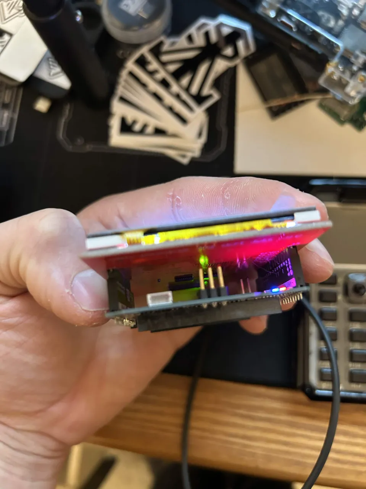

# Q-Marauder

**A Debian-native wireless field console for Arduino UNO Q.**

Black Wire Militia × Marauder-inspired tooling, with a graphite, cyan, and red UI.
MIT application code. Independent project; not an official JustCallMeKoko release.

**[Get started: Windows USB installer + photos](docs/GETTING-STARTED.md)** ·
**[Bill of materials](docs/BOM.md)** · **[Downloads](https://github.com/valleytechsolutions/Q-Marauder/releases)** ·
**[External Alfa radio](docs/USB-RADIO.md)** · **[Usage wiki](https://github.com/valleytechsolutions/Q-Marauder/wiki)**

**[BLE Lab setup](docs/BLE.md)** · **[ChimeraBLE / Unified Blue status](docs/BLE-PARITY.md)** ·
**[Browser installer feasibility](docs/WEB-INSTALLER.md)** · **[Desktop lab](docs/DESKTOP.md)** ·
**[UPS and handheld power](docs/POWER.md)**

**[Flock / Sky Spy / BLE capture how-to](docs/DETECTION.md)** · **[Active test status](docs/ACTIVE-TESTS.md)**



> **0.1.0 foundation alpha — not a full Marauder port or flashable OS image.**
> Runs on the UNO Q's existing Debian installation. The native ILI9486 display now renders.
> Upright portrait, direct touch and theme switching are confirmed on the test shield; see [display setup](docs/DISPLAY.md) for the remaining checks.
>
> **External USB radio is experimental:** initial capture worked, but a detach test
> exposed a kernel fault. With scatter/gather disabled, two subsequent detach/reconnect
> cycles and capture passed. Injection is still unverified; extended stability testing
> remains. See [current radio evidence](docs/USB-RADIO.md).

## Works today

- Actual Wi-Fi AP discovery through NetworkManager, including observed 2.4/5 GHz networks.
- BlueZ BLE discovery with fresh RSSI, address type, service UUIDs and advertising metadata.
- Selected-device signal tracking, configurable BLE watchlists and Axon/TASER candidate presets.
- Received BLE advertising PCAP with packet-based Flock/Meta/Axon candidate analysis;
  44–49 real HCI reports per test window. Remote ID decoding covers all six message
  families and reference-encoder fixtures. No real Flock/drone detection is claimed.
- [ChimeraBLE-compatible OUI list](docs/OUI.md): the same /24 source, with all 40,099
  prefixes and names checked against its generator. Public-address vendor hints appear
  on the TFT and browser; randomized addresses are not assigned a vendor by OUI.
- Interactive selected-device pairing in the browser, with code entry/comparison
  and cancellation. Pairing and reconnecting verified with the owner's Flipper Zero.
- GATT inventory, read/write and bounded notification backends; physical GATT
  validation on a Flipper Zero includes battery reads and harmless RPC ping exchanges.
  Bounded value/descriptor snapshots are also verified. HID report-map parsing and
  input observation are implemented with fixture tests; physical HID validation remains.
  See [BLE Lab limits and evidence](docs/BLE.md).
- AP-count channel chart, filtering, device diagnostics, and a feature-by-feature port inventory.
- Repeated Wi-Fi survey sessions with SQLite persistence and CSV/JSON exports.
- Fresh gpsd position ingestion; no coordinates are fabricated when GPS is absent.
- A loopback-only dashboard accessed through USB ADB forwarding or an SSH tunnel.
- Original BWM and Marauder artwork in the application startup screen.
- Native 320 x 480 portrait firmware with direct row taps, large Back/page buttons,
  18 menu groups, and 182 selections. Unported functions are explicitly marked planned.
- **Settings → Themes**: BWM, Marauder, Biscuit Shop and Valleytech, shared between
  the browser and TFT with supplied background artwork and saved preferences.
- Native Wi-Fi/BLE result pages with tap-to-open details, saved scan restoration,
  BLE target/characteristic selection, read/write/notify and pairing keypad controls.
- A **Q-Marauder Lab** Debian application launcher and wide-screen workspace;
  browser layout verified, physical HDMI/hub testing still required.
- Receive-only, eight-second radiotap PCAP export on the configured lab channel,
  limited to 512 KiB / 2000 packets. A 321-packet live capture and export were verified.
- Optional bounded lab recon, injection-check and deauth backends, with local report
  history and a separate privileged worker. PC-forwarded Alfa monitor reception is
  verified; injection remains unverified and deauth stays gated. See [lab setup](docs/LAB.md).
- Flock/Sky Spy Wi-Fi channel-sampling backends are implemented with fixture tests;
  live validation is blocked while the external Alfa is absent. BLE beacon-test
  registration/cleanup works, but independent RF reception remains unconfirmed.

**Not a complete attack toolkit yet.** Platform BLE spam, Wi-Fi floods/portals,
GATT emulation/proxy and several upstream modes remain unimplemented. See the
[explicit active-test matrix](docs/ACTIVE-TESTS.md) before relying on a menu label.

## Easiest installation: Windows + USB

Complete Arduino's first setup, extract this repository/release, and place Google's
Platform-Tools in `.tools/platform-tools`. Double-click **Install-QMarauder.cmd**.
It detects the board, installs the console, backs up and uploads the portrait TFT
sketch, and opens the dashboard. Only the tested factory display core is accepted.
After a reboot, **Start-QMarauder.cmd** starts the console again.
For a previously working screen that stays blank, **Repair-Display.cmd** restarts
the display MCU and restores saved settings through the console.

Follow the [illustrated getting-started guide](docs/GETTING-STARTED.md) for exact
steps, calibration, troubleshooting, and the console-only option. No replacement
Debian image or browser-only flasher is supplied in this alpha.

## Linux / SSH quick start

The supplied Arduino Debian image already provides Python, NetworkManager, and BlueZ.
The console uses Python's standard library. BLE Lab additionally needs Debian's
`python3-dbus` and `python3-gi`: run `sh scripts/install-ble-dependencies.sh`, or
double-click `scripts/Enable-BLELab.cmd` after the Windows installation.

```sh
git clone https://github.com/valleytechsolutions/Q-Marauder.git
cd Q-Marauder
python3 -m qmarauder doctor
python3 -m qmarauder serve
```

From a computer with Google's official platform-tools:

```sh
adb devices
adb -s YOUR_DEVICE_SERIAL forward tcp:8788 tcp:8787
```

Open **http://127.0.0.1:8788**. Alternatively use
`ssh -L 8788:127.0.0.1:8787 arduino@YOUR_BOARD`.
The console intentionally listens only on the board's loopback interface.

For a Windows USB deployment, run `scripts/Deploy-UnoQ.ps1` from a source checkout:

```powershell
.\scripts\Deploy-UnoQ.ps1 -Serial YOUR_DEVICE_SERIAL -AdbPath C:\path\to\adb.exe
```

For a persistent Linux install, use `sh scripts/install.sh`, then follow its output.
See [installation and recovery](docs/INSTALL.md) before enabling startup on boot.

## The hardware split matters

The Qualcomm QRB2210 runs the Linux radio backends, storage, and console. The STM32U585
owns the UNO shield headers. `firmware/uno_shield` drives the parallel ILI9486 shield
and exchanges small status/action messages with the Linux application. Follow
[display setup](firmware/README.md) for the tested factory core. The browser console
and the portrait TFT are separate renderers sharing the same radio worker.

The connected development board reports `ath10k_snoc`, 2.4/5 GHz channels, and monitor
mode support. Live monitor tests returned zero packets; ten directed probe
submissions returned no responses. Capture and injection remain **unverified**.
Advanced Marauder functions remain individually tracked in
[the parity plan](docs/PARITY.md) and the Modules view. A compatible external radio
now works experimentally for scanning and monitor reception: the PC-connected MT7921 uses USB/IP
and supplemental modules built for this board's exact kernel. Injection checks have
not received replies. See
[USB radio support](docs/USB-RADIO.md).

## Development

| Folder | Purpose |
| --- | --- |
| `qmarauder/` | Debian console, radio workers, storage and browser UI |
| `firmware/uno_shield/` | Portrait TFT and resistive-touch sketch |
| `scripts/` | Install, launch, flash, diagnostics and release helpers |
| `docs/` | Illustrated setup, BOM, hardware evidence and feature status |
| `packaging/` | Optional systemd console and restricted radio worker units |
| `tests/` | Backend, protocol, parser and native touch checks |
| `licenses/` | Upstream license notices |

```sh
python3 -m unittest discover -s tests -v
python3 scripts/build_catalog.py
python3 scripts/package.py
```

Use [architecture](docs/ARCHITECTURE.md), [display bring-up](docs/DISPLAY.md), and
[hardware evidence](docs/HARDWARE.md) to pick the next work item. Dragon Detector,
and Squachwach remain integration targets. AXEOFF BLE currently provides public
identifier candidate matching; complete passive BLE/Wi-Fi/audio parity remains.

Scans can contain identifiers and locations. Records stay on the device until you
export them. Use radio tests only in environments you own or are authorized to assess.
Do not commit local captures, credentials, or survey databases.

Application license: [MIT](LICENSE). Artwork and dependencies: [notices](THIRD_PARTY_NOTICES.md).
