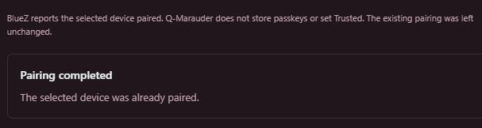

# BLE Lab on UNO Q

The Debian backend uses BlueZ over D-Bus. The STM32 draws the portrait interface;
it does not run an ESP32 BLE stack. This is an independent, partial implementation
of workflows described by ChimeraBLE and Unified Blue, not either firmware running
on UNO Q. See [the complete status map](BLE-PARITY.md).

## Install once

After the normal Q-Marauder installation, double-click
`scripts/Enable-BLELab.cmd` on Windows. It finds one UNO Q and installs Debian's
`python3-dbus` and `python3-gi` packages. Enter the **board's Debian password** in
that window when requested. No password is saved. The board needs Internet access.
On the board directly, run `sh scripts/install-ble-dependencies.sh`.

These packages are already installed on the development UNO Q. Wi-Fi, display and
the browser console use the standard library; the new BLE jobs need these packages.

## Discovery and target selection

1. Open **Bluetooth → Discover BLE** in the USB browser console.
2. Find your device and select **Use as target**. Only that address is used by
   connection, characteristic and signal-tracking jobs.
3. **Settings → BLE test device** shows the saved selection and adapter.
   `hci0` is onboard on the tested setup; verify adapter numbering on other boards.
4. For a device that requires authentication, follow **Pair selected device**
   below before inspecting GATT. Choose **Track signal** or **Inspect GATT**.
   On the TFT these are under
   **Bluetooth → BLE foxhunt / GATT inventory**. Selection currently requires the browser.

Discovery returns names, RSSI, public/random address type, service UUIDs,
manufacturer/service data and a small set of fingerprints. These are **aggregated
BlueZ properties**, not individual raw advertisements. There is no claim of
passive-only scanning: BlueZ discovery can send scan requests. Fingerprints never
establish identity or surveillance activity. Private addresses can rotate; select
the new observation if your target changes address.

## Pair selected device

The browser's **Bluetooth → BLE Lab → Pair selected device** registers a temporary
BlueZ agent for the selected address and adapter. It supports passkey/PIN entry,
numeric comparison, authorization and displaying a code for entry on the peer.
It never accepts a comparison automatically. Pairing is currently a browser
workflow; the TFT does not have a pairing-code keyboard.

1. Keep the peripheral nearby, awake and unlocked, and close other apps that use
   its Bluetooth connection.
2. Click **Pair selected device** when ready to watch both screens.
3. Enter the **new** code directly into the focused browser field and press
   **Send code** promptly. The peripheral can expire the request before the
   application's overall timeout. For comparison prompts, confirm only when
   both screens show the same code.
4. Wait for **Pairing completed**, then choose **Inspect GATT**. **Cancel pairing**
   stops the job. An expired attempt needs a fresh code and another click.

Entered codes travel over the local browser connection and worker pipes, and are
not saved in settings, reports or application logs. BlueZ retains a successful
bond in its own storage. The job does not set `Trusted`, become the system's
default agent, remove bonds or disconnect a pre-existing connection. Each new
pairing connection is closed when the job finishes. An already-paired device is
reported without changing it. Unpair/bond-management controls are still pending.

### Flipper Zero / Momentum

Use the normal, unlocked home screen and Bluetooth enabled. Momentum's standard
serial profile requests a displayed PIN; some apps can suppress that screen.
If no code appears, cancel the attempt, exit the app, toggle Bluetooth OFF/ON and
return home before retrying. Do not use **Unpair All Devices** for this check.
The browser waiting for a passkey is evidence of a BlueZ request, not proof that
the peripheral displayed it. A canceled authentication result does not establish
whether a code was wrong or the peer's timer expired.

References: [BlueZ agent API](https://bluez.readthedocs.io/en/latest/agent-api/),
[Momentum serial profile](https://github.com/Next-Flip/Momentum-Firmware/blob/dev/targets/f7/ble_glue/profiles/serial_profile.c),
[Momentum pairing screen](https://github.com/Next-Flip/Momentum-Firmware/blob/dev/applications/services/bt/bt_service/bt.c).

## GATT operations

Inspect GATT lists services and characteristics. Choose **Use UUID**, then Read,
Listen (10 seconds), or explicitly Write a hexadecimal value. Writes support
request and command modes and must be 1–512 bytes. The UUID must identify exactly
one characteristic; ambiguous duplicate UUIDs are refused. There is no arbitrary
D-Bus path or shell command API.

Every job has a deadline and disconnects its own connection on completion/error.
An already-connected target is refused so an existing session is not taken over.
Notification capture stops after 10 seconds and stores at most 256 events. Jobs
do not pair automatically, remove bonds, change adapter power or reset Bluetooth.
Use the explicit pairing workflow for protected characteristics. No generic write payload is safe for
every peripheral; use that device's protocol documentation.

Reports and notifications are in **Field log → JSON**. CSV contains summary fields;
use JSON for the full nested advertising/GATT data. Selecting a target does not
start a job. Restarting the console never repeats a write or notification request.

## Watchlist detection

Under **Settings → BLE watchlist**, add up to 32 named rules. Supported matches:
exact address, public OUI, company ID (four hex digits), service UUID (16-bit or
full), and case-insensitive name substring. OUI rules intentionally ignore random
addresses. Rules are OR matches; they do not implement same-packet composites.

Run **Bluetooth → Scan watchlist**, or **Counter surveillance → BLE watchlist scan**
on the TFT. Results explain which rules matched. A saved name rule for your own
test device is a useful end-to-end check. No vendor signature pack is enabled by default.

## Validation and limits

On 2026-10-15, the physical UNO Q's hci0 discovered the owner's Flipper Zero and
other advertising devices with real metadata. A configured name watchlist matched
the selected Flipper, and a 20-second signal window returned fresh RSSI samples.
The Flipper's unpaired connection ended before GATT discovery. Explicit pairing
subsequently completed on the Momentum device: BlueZ reported `Paired`, `Bonded`
and `ServicesResolved`. Reconnecting through the normal GATT backend returned
**5 services and 15 characteristics**. A standard Battery Level read (`2a19`)
returned `55` hex, or **85%** at test time.

The browser/API write backend completed both with-response and without-response
writes of a documented, empty Flipper RPC PingRequest. A separate diagnostic
used the same worker's 10-second subscription code, sending a ping while
subscribed to the Flipper's TX characteristic: each write mode produced exactly
one indication containing the expected PingResponse. This verifies received
indications and the ping exchange. The diagnostic is not a general multi-operation
GATT session feature in the UI. A normal battery notification window completed
with zero changes; that does not imply a failed subscription.

Each job disconnected afterward, and subsequent jobs reconnected using the bond.
These results validate this Flipper and these characteristics; they do not prove
compatibility with every BLE peripheral, HID profile or emulation mode. Mock tests
also cover ambiguous targets, stale pairing responses, connection ownership and
cleanup. Test passkeys, device addresses and lab observations are not in the repo.

Ping protocol references: [Flipper RPC envelope](https://github.com/flipperdevices/flipperzero-protobuf/blob/dev/flipper.proto),
[PingRequest / PingResponse](https://github.com/flipperdevices/flipperzero-protobuf/blob/dev/system.proto).

If GATT fails, ensure Bluetooth is enabled on the device, disconnect its existing
phone session and inspect any pairing prompt. Do not clear other devices' bonds.
Descriptor reads, HID decoding, clone/emulation and MITM are not supplied in this
build. RSSI tracking reports signal change, not distance.
