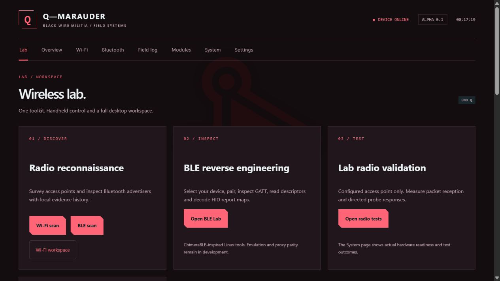

# Q-Marauder Lab on an external display

The installer adds **Q-Marauder Lab** to Debian's Applications menu. It uses the
same service and local data as the portrait TFT. The Lab workspace groups Wi-Fi,
BLE, detector modes, radio tests and session exports; unavailable backends show
their limitations. This is an integrated Q-Marauder app, not a bundled Kali image
or a claim that every upstream firmware feature has been ported.



## Connect

1. Stop radio work and shut down Debian before changing the power arrangement.
2. Connect a USB-C hub with **DisplayPort Alt Mode → HDMI**, USB keyboard/mouse
   ports and adequate PD input. Power the hub and connect its host lead to UNO Q.
3. Connect HDMI to the monitor, boot, and sign into the Debian desktop.
4. Open **Applications → Q-Marauder Lab**. Or run:

   ```sh
   ~/.local/bin/q-marauder desktop
   ```

The launcher reuses a running console or starts one on demand, then opens Chromium
in an application window. It keeps browser sandboxing enabled and binds the
service to loopback. Closing Chromium leaves the service available to the TFT.
No boot service is enabled by installing the desktop launcher.

Arduino documents this monitor arrangement in the
[UNO Q user manual](https://docs.arduino.cc/tutorials/uno-q/user-manual/).
The [Arduino USB-C Hub](https://docs.arduino.cc/hardware/usb-c-hub-8-in-1)
is one candidate; confirm the complete power chain before buying.
XFCE and Chromium were found on the development board. **HDMI output and hub
power behavior have not been physically tested in this project.**

## Switch between PC tether and standalone

The board has one USB-C connector. Moving it from the PC cable to a hub removes
ADB forwarding and any Alfa forwarded from that PC through USB/IP. To use the
Alfa in desk mode, attach it directly to the powered hub and revalidate its driver,
interface name and lab profile. Do not assume the PC-forwarded interface remains.

The portrait TFT stays on the STM32 and uses the same saved orientation and
calibration. Browser and TFT share the selected BLE target and one radio-job queue.
Saved scan results survive service restarts and are labelled as saved observations.

For updates from the existing PC setup use the illustrated
[installation guide](GETTING-STARTED.md). For battery choices see [Power](POWER.md).
