# Q-Marauder UI gallery

[Install](GETTING-STARTED.md) · [User guide](https://github.com/valleytechsolutions/Q-Marauder/wiki) · [Credits](../CREDITS.md) · [Feature status](BLE-PARITY.md)

The browser and portrait TFT share the same Debian service. These images show the
current interface; a visible menu item does not establish that its backend or radio
hardware is fully validated. See the feature-status guides for that evidence.

## Browser workspace

### Linux Wi-Fi and Bluetooth tools

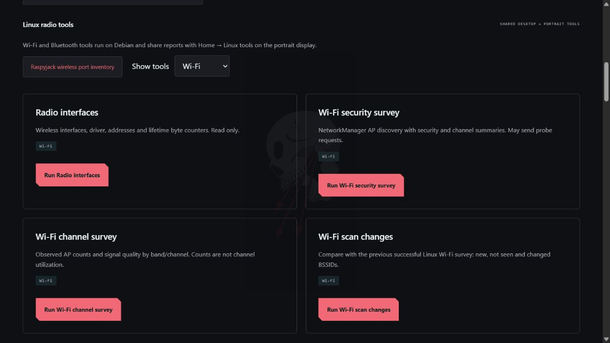
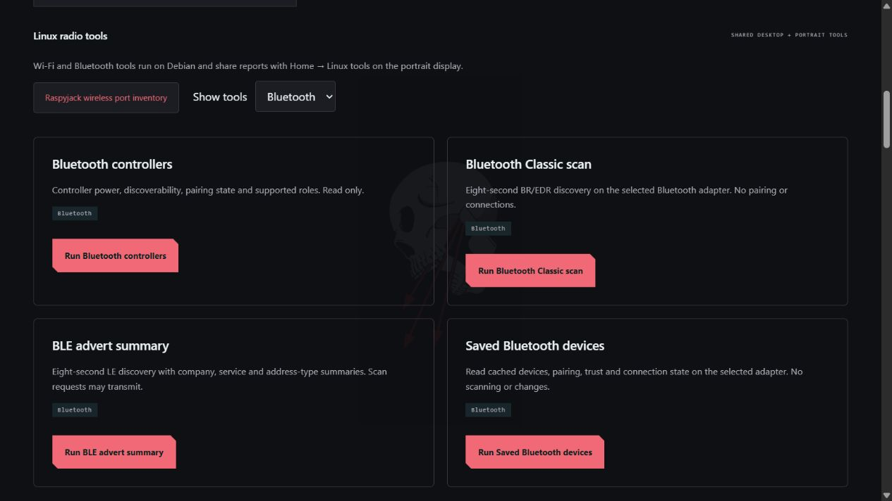

Actual captures of the shared console, with radio filtering and four tools per view.
The native Debian application hosts this interface. These images were captured in
a browser; they are not evidence of an HDMI hardware test. The [survey guide](SURVEY-TOOLS.md)
explains the new analysis tools and saved-report controls.

### Full workspace

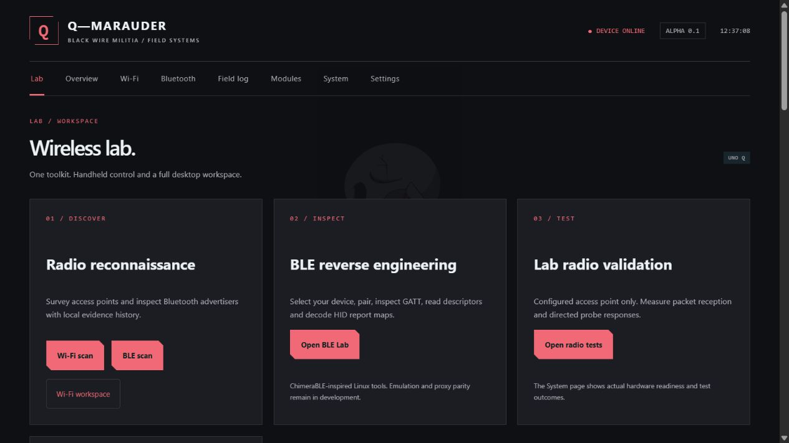

Actual screenshot of the running console on October 16, 2026. The desktop workspace
groups discovery, Bluetooth and detection tools into large cards. This is a browser
screenshot, not a photograph of an HDMI-connected monitor.

## Theme settings

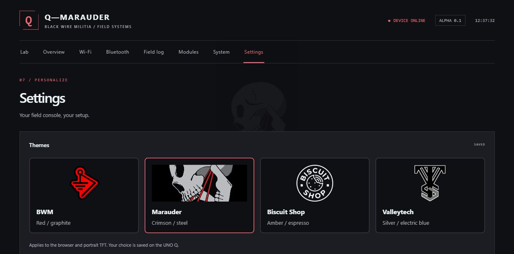

Actual browser screenshot, cropped below the theme controls to exclude private
device settings. Theme preferences are shared with the portrait TFT.

## Portrait touchscreen

### BWM startup

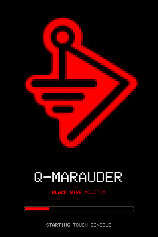

The logo stays visible while a red activity bar moves. Startup opens the menu
without orientation or calibration taps; both adjustments remain in Settings.
This is a single rendered frame of the MCU loading screen, not a photograph.

### Menus and themes

These are **320 × 480 software renders of the current firmware drawing code**, not
photographs of the physical panel. They use the same Adafruit GFX primitives, font,
menus, colors and encoded artwork as the sketch. No scan observations are fabricated:
counters are zero and the bridge indicator is disconnected in these preview scenes.

<table>
  <tr><th>BWM · Home</th><th>Marauder · Detection</th></tr>
  <tr>
    <td>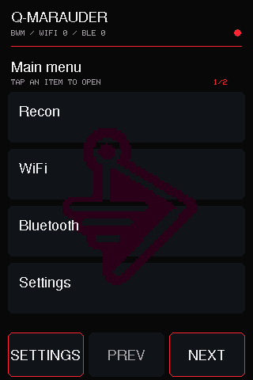</td>
    <td>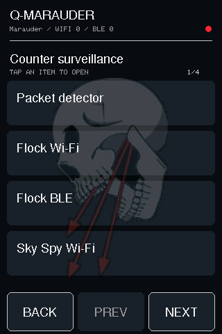</td>
  </tr>
  <tr><th>Biscuit Shop · Settings</th><th>Valleytech · BLE Lab</th></tr>
  <tr>
    <td>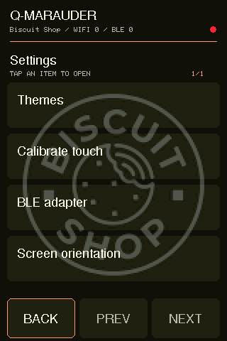</td>
    <td>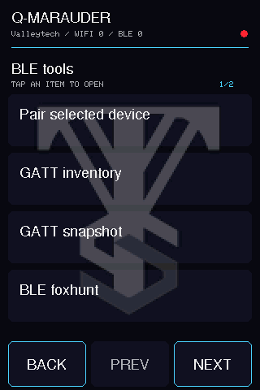</td>
  </tr>
  <tr><th>Marauder · Survey tools</th><th>BWM · Report history</th></tr>
  <tr>
    <td>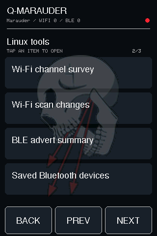</td>
    <td>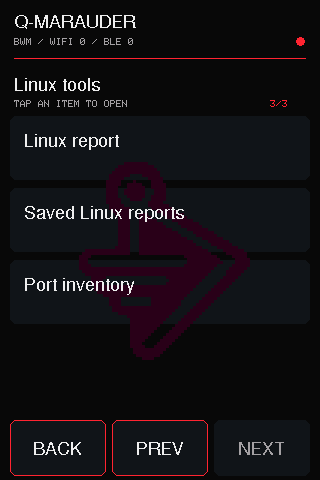</td>
  </tr>
</table>

The interface uses direct row taps with large Back and page controls. On the
physical test shield, upright orientation, direct taps, themes, BLE selection and
GATT Read value were previously confirmed by the owner. On October 16, the owner
also confirmed the new channel survey and saved-report OPEN flows. The images
themselves are software renders. Wiring, calibration, refresh rate,
panel color reproduction and real touch response cannot be assessed from them.

<details>
<summary>Theme picker and reproducible rendering</summary>

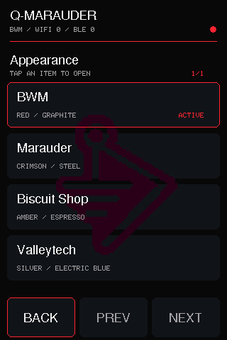

From a source checkout on Linux with Python 3, a C++17 compiler and a separately
installed **Adafruit GFX 1.12.6** library:

```sh
python3 scripts/render-tft-gallery.py --gfx /path/to/Adafruit_GFX_Library
```

The renderer compiles the sketch's drawing section with a software canvas. It does
not flash the board or run radio jobs. [provenance.json](images/tft/provenance.json)
records the sketch SHA-256, library version and scene selections. The source hash
uses LF line endings. Arduino and bus shims under `scripts/tft-preview/` are used
only for documentation rendering, not by the physical firmware build.

</details>

## Capture and detection view

The [Raspyjack integration guide](RASPYJACK.md) also shows the new portrait Linux
tools menu. Its render is included in the same source-hash provenance record.

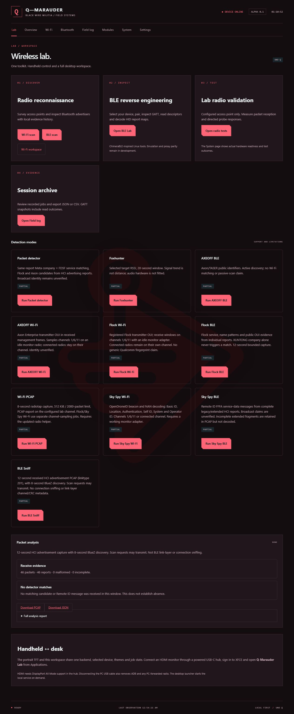

An earlier actual console screenshot from the alpha validation work. Received BLE
advertising reports are evidence of reception; the image does not demonstrate a
real Flock or drone detection. Read the [detection guide](DETECTION.md) for candidate
confidence, decoder coverage and hardware limits.

## Development hardware


Owner-supplied photograph of the development assembly. The repository's original
white-screen photograph documents the pre-initialization state, rather than a
working menu. A photograph of the working portrait UI has not yet been supplied.
See the [bill of materials](BOM.md) and [display guide](DISPLAY.md) before selecting
a shield: similar red boards may use different controllers or pin mappings.

Artwork and photographs retain the exclusions described in
[third-party notices](../THIRD_PARTY_NOTICES.md). Project and developer attribution
is collected in [CREDITS.md](../CREDITS.md).
