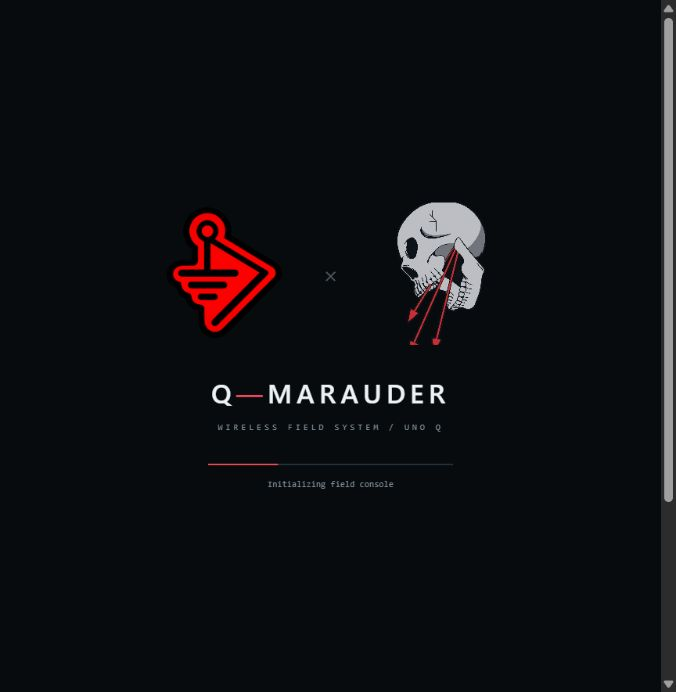
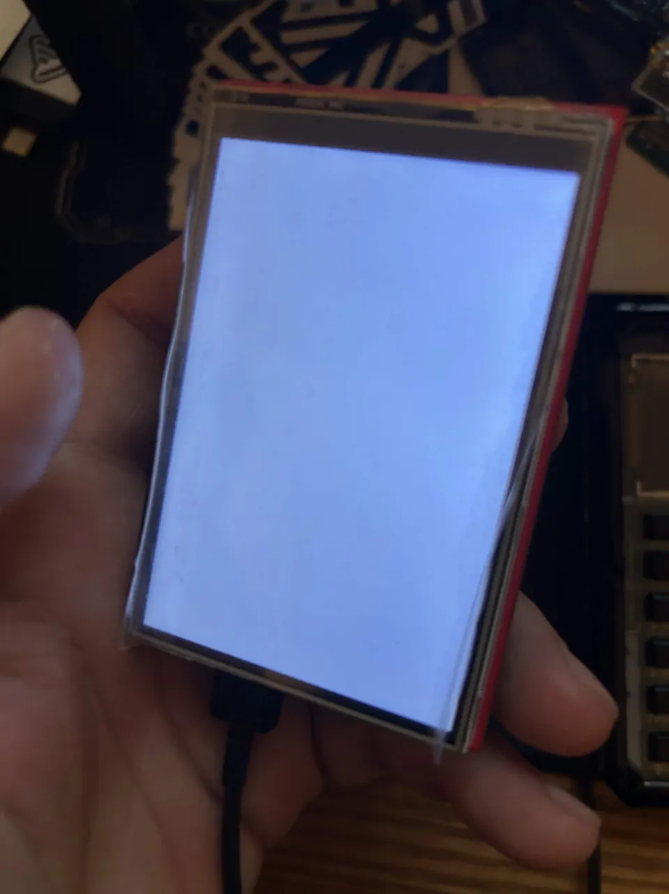

# Get Q-Marauder onto your UNO Q

This alpha installs an application on **Arduino's existing Debian system** and a
portrait GUI sketch on the STM32. You do not download an ESP32 `.bin`, erase Debian,
or use a browser flasher. The supplied Windows launcher handles the application and
TFT upload together, over one USB data cable.

## 1. Assemble the hardware

See the [bill of materials](BOM.md). Power the board off before fitting the shield.
Align every shield pin with its labeled UNO header position; do not offset a row or
force it. The supported display is the **parallel, dual-header UNO shield**, not a
single-row SPI breakout. The board marking or seller title alone does not prove its
controller or electrical compatibility.


*Actual development assembly. The shield sits above the UNO Q; the USB cable remains
accessible. This photograph identifies the physical form factor, not every clone's pinout.*

## 2. Complete Arduino setup once

Use [Arduino App Lab](https://docs.arduino.cc/software/app-lab/) to initialize your
UNO Q and connect its Debian side to Wi-Fi. Keep the standard `arduino` account for
these alpha scripts. Record your board password locally. Close other apps/sketches
that use the MCU serial bridge before installing Q-Marauder.

The display uploader is currently validated only with **Arduino Zephyr core
0.11.0-rc5**. Newer factory images may have a different runtime. The installer checks
this and stops before TFT upload if it differs; do not downgrade a board blindly.
The Linux console can still be installed with `-AppOnly` below.

## 3. Download and extract

1. Open [Releases](https://github.com/valleytechsolutions/Q-Marauder/releases) and
   download the latest source ZIP, or use GitHub **Code → Download ZIP**.
2. Right-click the ZIP → **Extract All**. Open the extracted folder containing
   `Install-QMarauder.cmd`. Do not run it inside the ZIP viewer.
3. Download [Google Platform-Tools for Windows](https://developer.android.com/tools/releases/platform-tools)
   from Google and extract the `platform-tools` folder into a folder named `.tools`
   inside Q-Marauder. You should have `.tools/platform-tools/adb.exe`.
   An existing `adb` on PATH also works. Google provides the download and its license.
4. Plug the UNO Q directly into the PC using a **data-capable USB cable**.

No Python or Arduino IDE installation is needed on the Windows PC. Compilation runs
on the UNO Q using its Arduino tools. The board needs Internet access for the pinned
display libraries on first installation.

## 4. Install and flash the display

Double-click **Install-QMarauder.cmd**. Keep USB and power connected until it finishes.
The launcher:

1. Finds exactly one initialized UNO Q, verifies the Linux account and display core.
2. Copies and installs the console; restarts only its own recognized preview process.
3. Compiles the display sketch and saves a private MCU backup on the board.
4. Uploads the sketch, leaving the Debian image and matching Zephyr runtime in place.
5. Opens the browser console at **http://127.0.0.1:8788**.

On the TFT, hold **USB at the bottom**. Tap the orientation whose text is upright
and readable, then firmly tap and release each calibration circle. Tap **WiFi →
Scan APs**; after completion, tap a network row for details. **Themes** selects BWM,
Marauder, Biscuit Shop or Valleytech. The Linux console saves the orientation,
touch calibration and theme.



*Actual browser startup screenshot. The physical TFT uses its own portrait renderer;
this is not a photograph of the TFT.*

The first full MCU backup can take **several minutes** and the TFT can appear frozen
while it is read. Keep power connected. Later installations reuse the retained backup.

The launcher uses a process-local PowerShell execution policy to run these local
scripts. It does not change your machine's PowerShell policy or any AI approval settings.

## 5. Starting again and updating

After rebooting the board, double-click **Start-QMarauder.cmd** to start the console
and reopen USB forwarding. Keep the folder and Platform-Tools together. The display
sketch remains installed, but live radio actions need the Linux console running.

Automatic boot is an optional, separate [service setup](INSTALL.md#start-on-boot).
For updates, extract the new release and rerun the installer. Saved observations
and calibration remain on the board. The first MCU backup is retained, not overwritten.

Advanced PowerShell examples from the extracted folder:

```powershell
# Existing Platform-Tools elsewhere:
.\scripts\Install-Windows.ps1 -AdbPath C:\Tools\platform-tools\adb.exe
# Console only; do not change the TFT sketch:
.\scripts\Install-Windows.ps1 -AppOnly
# More than one board connected:
.\scripts\Install-Windows.ps1 -Serial YOUR_UNO_Q_SERIAL
```

## If something looks wrong

| Symptom | What to check |
| --- | --- |
| Board not found | Complete Arduino setup, use a data cable, close competing serial tools, check `adb devices`. An unauthorized device must be authorized through Arduino's setup flow. |
| Unsupported core | Use `-AppOnly`; record `arduino-cli core list` and consult [firmware notes](../firmware/README.md). The uploader deliberately stops before changing an untested runtime. |
| White panel | Backlight power alone is not a working GUI. Check that the TFT sketch was successfully uploaded and the shield matches the supported parallel wiring. |
| Mirrored/upside-down text | Select the readable orientation during setup; use the display's recalibration option if needed. |
| Touch misses buttons | Recalibrate using press **and release** at all three circles. Avoid holding a finger across targets. |
| Scan starts without rows | Wait for completion; check the browser console and board diagnostics. Both Linux console and native bridge must be running. |
| Port 8787 occupied | Do not kill arbitrary processes. Stop the existing Q-Marauder service/preview using [installation instructions](INSTALL.md). |
| Alfa absent | A PC USB dongle does not automatically belong to the board. Follow [external-radio setup](USB-RADIO.md). |



*Before firmware initialization: this is the original white-screen symptom, not a
finished GUI screenshot. A lit panel does not establish controller communication.*

## Capture and lab testing

Regular Wi-Fi/BLE discovery works with the onboard radios. Monitor capture and
injection have separate driver requirements. Check the current
[validation table](USB-RADIO.md) before buying an adapter or expecting attack parity.
Set your own local lab profile using [LAB.md](LAB.md); no network identifiers or
credentials are shipped. Wardriving and many upstream Marauder functions remain planned.

For Linux/SSH installation, boot service, backup and recovery, see [INSTALL.md](INSTALL.md).
