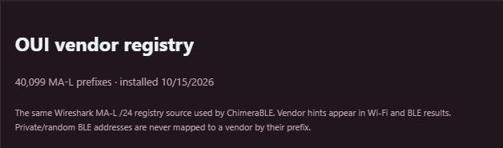

# OUI vendor lookup

Q-Marauder implements the OUI list workflow used by
[ChimeraBLE](https://github.com/MatthewKuKanich/ChimeraBLE): the **MA-L /24 subset**
of [Wireshark's manuf registry](https://www.wireshark.org/download/automated/data/manuf).
ChimeraBLE does not commit its generated `oui.bin`; its generator downloads this
source. Q-Marauder independently parses the same prefixes and long vendor names.
No ChimeraBLE GPL implementation or generated table is bundled into the MIT code.

The installer downloads the registry once if missing. It is stored separately at
`~/.local/share/q-marauder/vendors/oui.json`, with source URL, download date and
SHA256. The development snapshot contains **40,099 prefixes**, source SHA256
`10a6ad3df6dd3033027d1d7b7cddf741d52e2a31da392201ea1af05fb14516f8`.
Future downloads may contain more entries. Wireshark asks users not to download
the registry more often than weekly.

Every prefix and vendor name in this snapshot matched ChimeraBLE's generator
when both parsed the same downloaded file. A live BLE scan returned eight public
address vendor matches; that is a lookup check, not an identity verification.



## Use

- Browser: Wi-Fi and BLE device rows show vendor hints; Settings shows registry status.
- TFT: BLE result subtitles/details show the vendor when a public address matches.
- Exports: observations include `oui_vendor` and BLE attribution notes.

OUI is a manufacturer-assigned address prefix, not proof of identity, product model,
ownership or surveillance activity. Random/private BLE addresses, locally assigned
MACs and multicast addresses are not attributed using this lookup. Longer /28 and
/36 assignments are omitted to match ChimeraBLE's OUI-list scope. Bluetooth company
IDs are a different registry; a radio vendor and an advertised company can differ.

## Refresh or install offline

On the UNO Q, from the source folder:

```sh
python3 scripts/update-vendors.py
# Or use a previously downloaded Wireshark manuf text file:
python3 scripts/update-vendors.py --source /path/to/manuf
```

Restart the console afterward so its cached registry status is refreshed. Offline
installation still works without this file; missing lookup data never stops scans.
The external registry retains its source's terms and is excluded from this
repository's MIT grant and release source bundles.
