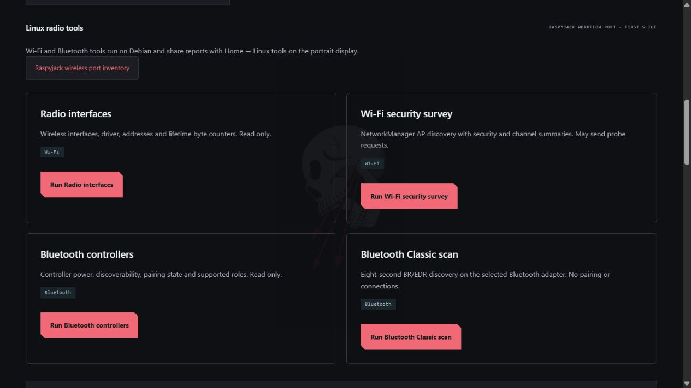
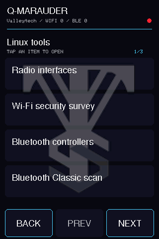

# Raspyjack wireless integration

Q-Marauder is beginning a Wi-Fi/Bluetooth workflow port of
[Raspyjack by 7h30th3r0n3](https://github.com/7h30th3r0n3/Raspyjack), inspected at
`8cbb74c1e2198bf477631c0903c19c35efb432fa`. The integration now has eight Linux
radio jobs, shared report history, a portrait menu and a native Debian application shell.
**This is not complete Raspyjack parity.**

Actual browser capture of the shared local console. The native Debian window hosts
this same interface; a physical-monitor acceptance check remains outstanding.

## Open the tools

On a connected monitor, sign into Debian and open **Applications → Q-Marauder Lab**.
The GTK/WebKit window hosts the full local console with no browser address bar.
Select **Lab → Linux radio tools**. The PC-tethered browser can use the same view.

On the portrait TFT, open **Home → Linux tools** (on the last menu page), or use
**Wi-Fi → Linux tools** / **Bluetooth → Linux tools**. Tap a tool to run it, then tap
any report row for details. Back returns to the tools. **Linux report** reopens the
most recent saved report. Pages contain four large touch rows.
**Linux tools → Port inventory** lists all 45 tracked Raspyjack entries with their
status and limitations. It is a reference list; tapping a planned entry opens its
status, not an unimplemented payload.

This is a software render from the current firmware drawing code, not a panel photograph.

| Tool | What runs on Debian | Limits |
| --- | --- | --- |
| Radio interfaces | Linux sysfs and `ip -j address show` | Read-only wireless driver, IP and byte-counter snapshot. Not injection validation. |
| Wi-Fi security survey | NetworkManager AP discovery and local summary | Security modes, hidden-name count, channels and mixed-security SSIDs. May transmit probes. Counts are not airtime; mixed modes do not establish an evil twin. |
| Bluetooth controllers | `bluetoothctl list` / `show` | Reads power, discoverability, pairing mode and supported roles for up to four controllers. Changes no controller settings. |
| Bluetooth Classic scan | BlueZ D-Bus `bredr` discovery for eight seconds | Selected adapter from Settings; no pairing or connections. Only fresh events enter the report. No SDP service enumeration yet. |
| Wi-Fi channel survey | NetworkManager discovery grouped by band/channel | AP counts and signal quality; no airtime, channel-width or interference measurement. |
| Wi-Fi scan changes | New discovery compared with the previous successful Linux Wi-Fi tool report | New/not-seen BSSIDs and changed names, channels, security or signal. No attack inference. |
| BLE advert summary | Eight-second BlueZ LE discovery | Company/service/address-type summaries; counts addresses, not unique physical devices or packets. |
| Saved Bluetooth devices | BlueZ local Device1 properties | Pairing, trust, connection and cached service UUIDs; does not initiate connections or change settings. |

See [Survey tools and report history](SURVEY-TOOLS.md) for step-by-step touchscreen
and desktop instructions. **Saved Linux reports** opens up to 100 recent reports
without restarting a job; on the TFT tap a row, then **OPEN**.

Jobs use the same serialized queue as existing Wi-Fi and BLE work. Reports remain
in the local session archive and survive application restarts. Desktop JSON exports
contain the full report; TFT details are shortened to fit the display. Failed and
interrupted jobs are reported rather than silently restarted.

## Wireless inventory and next ports

[Machine-readable inventory](raspyjack-inventory.json) records **45 entries**:
every Python payload in the pinned upstream `wifi/` and `bluetooth/` directories,
plus selected related reconnaissance and radio utilities. Search **Raspyjack** in
**Modules** to see each entry's source and current status. A planned entry has no
executable backend. The eight working Linux tools have their own catalog records.

| Area | Current position | Next work |
| --- | --- | --- |
| AP discovery, OUI, security/channel views | Existing discovery plus the new survey/report | Selected-interface controls and persistent AP/client monitor views |
| Bluetooth Classic / BLE / GATT | Classic discovery added; existing BLE/GATT tools reused | Selected-device SDP enumeration and additional service decoding |
| Wireless capture and detection | Existing bounded PCAP, Flock/Meta/Axon candidates and Remote ID decoder | External-radio validation and continuous, cancellable capture workflows |
| Wi-Fi active tests | Existing bounded configured-lab test remains; injection unverified | Adapter validation before adding additional upstream workflows |
| BLE advertising / active tools | Existing bounded lab beacon test; broader upstream modes unported | Explicit controller support and owned-device validation for each mode |
| Report browsing | Local session archive and desktop/TFT Linux report history | More saved analysis views and broader report-type coverage |
| Payload IDE / arbitrary upstream scripts | Not imported | Each future integration needs its own parameters, dependencies and status; no unrestricted root payload runner is supplied |

RFID, NFC, sub-GHz and SDR are outside this integration's scope, as are the unrelated
remote-access, exfiltration, credential, game and media payload families. Upstream
Pi GPIO/Waveshare drivers do not drive the UNO Q's STM32-connected ILI9486 shield.
The desktop and portrait renderers share actions and reports rather than screen pixels.

## Install/update

Use the existing [Windows USB installer](GETTING-STARTED.md) from a checkout that
contains this integration. Updating both the Debian app and TFT is required for the
new native **Linux tools** menu; the firmware advertises `qm-display/10`.
An app-only update adds desktop tools but cannot add menus to an older MCU sketch.
The tested factory Zephyr core requirement still applies.

For native app dependencies and explicit shell selection, see [Desktop lab](DESKTOP.md).
No Raspyjack installer is run on the UNO Q, and no Raspberry Pi kernel/image is flashed.

## Attribution and validation

[Credits](../CREDITS.md) and [third-party notices](../THIRD_PARTY_NOTICES.md) identify
the upstream relationship and retain Raspyjack's MIT notice. The upstream source is
a reference checkout, excluded from release packages. Q-Marauder implements this
first set of backends independently using Linux and BlueZ interfaces.

Tests cover security categorization, controller parsing, interface filtering,
BR/EDR discovery cleanup, saved reports, native action retry handling, TFT framing
limits and the desktop navigation boundary. Hardware results are recorded in
[validation](VALIDATION.md); no full upstream feature or attack parity is claimed.
