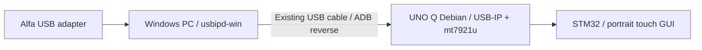

# Use a PC-connected Alfa with the UNO Q

**USB forwarding, Wi-Fi scanning and monitor reception work on the development
unit. Injection has not been verified.** The adapter stays plugged into the Windows
PC. The UNO Q imports it through the existing USB ADB connection and runs the Linux
driver and radio jobs itself. No WSL or virtual machine is required.



## What was actually validated

Development evidence, 2026-10-15. Counts describe bounded samples, not benchmarks.

| Check | Result |
| --- | --- |
| USB identity | `0e8d:7961`, MediaTek MT7921 USB family; exact Alfa retail model not independently confirmed |
| Windows | Official usbipd-win 5.3.0 x64 installed; installer SHA-256 and Authenticode signature verified |
| UNO Q kernel | `6.16.0-geffa8626771a`; original kernel retained |
| Driver | Exact-source supplemental USB/IP and mt76/mt7921 modules compiled, installed and loaded |
| Firmware | Debian `firmware-mediatek` 20250410-2; adapter firmware reports November 2024 build |
| USB import | `vhci_hcd` imports the adapter at USB High Speed; `mt7921u` creates a separate Wi-Fi interface |
| Scanning | Alfa scan returned 22 AP entries; onboard Wi-Fi stayed connected |
| 2.4 GHz monitor reception | Eight-second sample: 235 received frames, 90 from the configured lab AP, 78 beacons |
| 5 GHz monitor reception | Sample: 233 received frames, 111 from the configured lab AP, 78 beacons |
| Injection | Ten-probe checks on both lab bands received zero matching replies; independent Aircrack-ng check received 0/30 replies |
| Deauthentication | Not transmitted: the successful-injection gate remains unsatisfied |
| 6 GHz / Bluetooth attacks / standalone hub | Not validated |

Normal Windows Wi-Fi drivers are not used for this route: usbipd shares the USB
device and the Linux driver owns it while attached. The PC's other network adapters
remain available. The Alfa's Bluetooth interface is part of the same composite USB
device; attachment does not establish Bluetooth capture or attack support.

## 1. Prepare Windows once

Install Q-Marauder using [Get started](GETTING-STARTED.md), then plug the Alfa into
the PC. Double-click **scripts/Setup-AlfaWindows.cmd**. Accept the Windows
administrator prompt for this driver installation. The script downloads the pinned
official x64 MSI if needed, verifies its hash and signature, and shares exactly one
device with ID `0e8d:7961`. Ambiguous/missing devices are rejected. It does not select
the Arduino, storage or other radios.

It disables usbipd's installer-created LAN firewall exception. The ADB tunnel uses
the PC's loopback address. The MSI hash is
`1c984914aec944de19b64eff232421439629699f8138e3ddc29301175bc6d938`.
Other Windows architectures need the appropriate official usbipd installer manually.

## 2. Prepare this specific UNO Q kernel once

The factory config disables `MT7921U`, `USBIP_CORE` and `USBIP_VHCI_HCD`. A Windows
driver alone cannot supply these Linux modules. Open an UNO Q terminal through App
Lab or `adb shell`, enter the deployed checkout, and run:

```sh
cd /home/arduino/q-marauder
python3 scripts/build-usb-radio.py
sudo python3 scripts/install-usb-radio-modules.py
```

Enter your **Debian board password** locally when requested. The build takes several
minutes and needs Internet and at least 800 MiB free space. It installs build tools,
USB/IP utilities and MediaTek firmware, then downloads the exact Arduino source:

- Commit: `effa8626771ad31536aafd3a5aa94cad7e528e23`
- Archive SHA-256: `148030b6653c790850bb6438a30925433418df2a7a4314fa84a6c2ac5a65caf0`
- Compiler: GCC 13.3; running config copied from `/proc/config.gz`.

The recipe refuses other kernels, accounts or ABI settings. This factory config
has module versioning disabled and no supplied `Module.symvers`; the build can
report unresolved kernel-export warnings. Matching vermagic is checked, and actual
module loading must succeed before attachment. This is a tested recipe for one
kernel, not a generic way to load arbitrary Linux modules.

Modules go under `/lib/modules/6.16.0-geffa8626771a/updates/q-marauder`; original
kernel modules, bootloader and kernel image stay in place. Linux marks these as
out-of-tree modules. Do not repeat the installer while an mt76 radio is loaded.
After a kernel upgrade, this module set needs a matching rebuild.

## 3. Connect and reconnect

Double-click **scripts/Connect-Alfa.cmd**. Enter the Arduino Debian password if
prompted. It establishes ADB reverse port 3240, loads the modules, imports only the
matching USB export, and reports its Linux interface (often `wlx...`). It disables
automatic connection on that external interface so the onboard management radio
remains in charge of the board's Wi-Fi connection.

ADB listens broadly on the board for reverse TCP ports. The attachment helper adds
one IPv4 and one IPv6 input rule blocking **non-loopback TCP port 3240**, using the
factory kernel's legacy iptables support. Existing rules are retained. This does
not affect the dashboard, ADB USB, SSH or ordinary Wi-Fi traffic.

Keep the PC awake and both USB devices connected. Re-run Connect-Alfa after a cable
reconnect or reboot. There is no background attach loop or automatic attack. The
current implementation is PC-dependent; it is not standalone wireless operation.

## 4. Select your lab radio

Use the printed external interface in your private [lab profile](LAB.md), together
with your own SSID and exact authorized AP BSSIDs. Re-run `install-radio-helper.py`
with that profile. Then use the TFT:

1. **WiFi → Scan APs**.
2. **WiFi → Sniffers → Lab packet recon**.
3. **WiFi → Attacks → Injection check**.

The console and TFT report actual counters. An idle external radio is temporarily
released from NetworkManager during a lab test so background scans cannot retune
it, then returned on completion or error. A connected management radio is not detached.
No-reply injection results remain inconclusive, and the deauth action stays blocked.

## Disconnect, recovery and removal

Let any lab test finish. On Debian, run `sudo usbip port` to find the imported Alfa's
**Port** number, then `sudo usbip detach -p PORT` for that port only. Use
`adb reverse --remove tcp:3240` on Windows. To stop sharing, run
`usbipd unbind --busid BUSID` in an Administrator terminal using the Alfa's current
bus ID from `usbipd list`; do not use `unbind --all`.

If attachment fails, inspect `dmesg`, `usbip port` and `q-marauder doctor`. Do not
replace the OS or force-unload a busy radio. Removing only the `updates/q-marauder`
directory after detaching/unloading, followed by `sudo depmod -a`, restores the
original module selection. The two port-3240 rules disappear at reboot; remove
them manually with the same `iptables-legacy` / `ip6tables-legacy` rule arguments
using `-D INPUT` if needed.

## Other hardware paths

A powered USB-C hub may allow direct attachment, but that arrangement is not
validated. It still needs the Linux driver/firmware. A separate Linux companion is
another possible architecture, but no remote radio backend is included here.

Sources: [Arduino kernel commit](https://github.com/arduino/linux-qcom/commit/effa8626771ad31536aafd3a5aa94cad7e528e23),
[usbipd-win release](https://github.com/dorssel/usbipd-win/releases/tag/v5.3.0),
[Linux mt7921u driver](https://github.com/torvalds/linux/blob/v6.16/drivers/net/wireless/mediatek/mt76/mt7921/usb.c),
[ALFA AWUS036AXML](https://www.alfa.com.tw/products/awus036axml).
